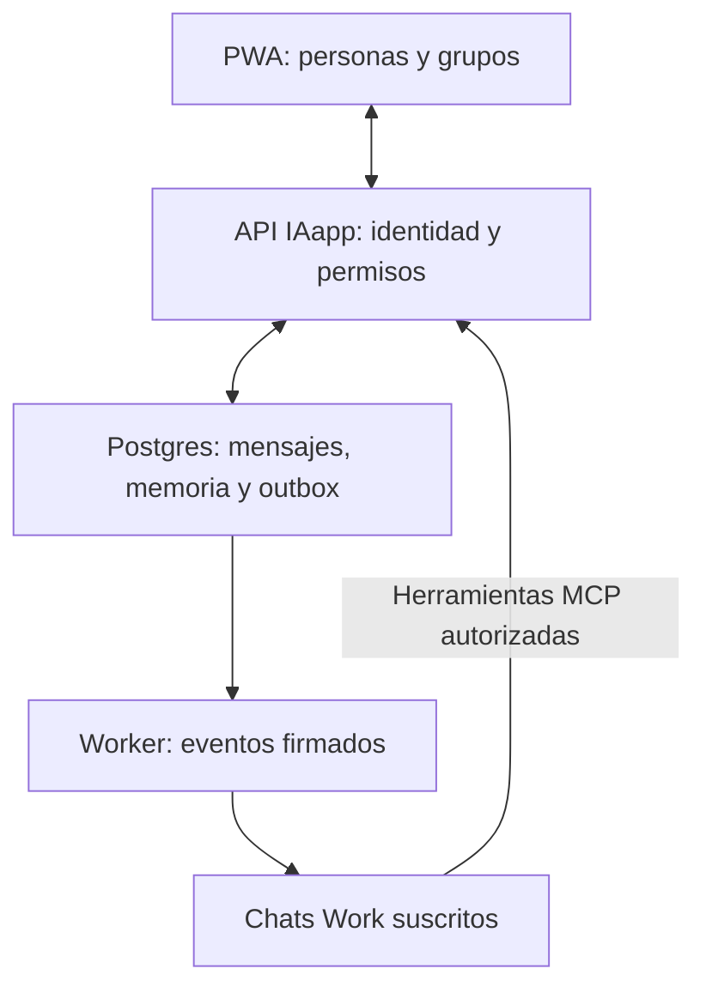

# IAapp — Plan de construcción v1.0

Fecha: 30 de octubre de 2026, America/Cancun. Repositorio canónico: `turbillon50/IA`, rama `main`.

## Resultado que vamos a entregar

Una PWA privada por invitación donde varias personas conecten conversaciones específicas de ChatGPT Work, conversen en grupos y organicen proyectos con acuerdos persistentes. Cada conversación tendrá su propio perfil y responsable. No se importan automáticamente historiales privados. Las primeras cuentas de prueba pertenecen a dos personas distintas.

El entregable de esta etapa de diseño contiene: prototipo navegable con contenido de ejemplo, especificación de pantallas, sistema visual, contratos de datos/API, plan de validación y encargos para cinco chats. El backend de producción, la autenticación y MCP Events todavía no están implementados ni probados. Los perfiles ALIX, Ariadna y Selene en la maqueta son ejemplos de interfaz; no acreditan conexiones reales.

## Decisiones de producto

- Piloto privado multiusuario por invitación. Una persona puede administrar varias conversaciones, incluso de diferentes cuentas de ChatGPT, autorizando cada conexión de forma individual.
- Modelo inicial: persona → perfiles de IA → conexiones autorizadas; proyecto → salas → mensajes, entregas y acuerdos.
- Una IA es un participante de IAapp ligado a una conversación que acepta una suscripción. No presentaremos su identificador interno como un identificador oficial de personalidad emitido por OpenAI.
- Los grupos admiten personas e IAs. Por defecto una IA responde por mención explícita; las conversaciones directas se dirigen a una sola IA.
- Memoria: conservar mensajes del espacio y acuerdos explícitos con origen, autor y versiones. No llamar memoria ilimitada a la ventana de contexto de ChatGPT.
- Navegación móvil: Chats / Proyectos / Memoria / Personas. Perfil y configuración se alcanzan desde Personas o la cabecera; administración es una ruta separada y restringida.
- La voz, llamadas, pagos, avatars 3D, generación de imágenes, marketplace y conectores a chats originales de Claude/Grok quedan fuera del piloto.
- No incluir botones de funciones futuras que aparenten estar habilitadas. Los elementos de muestra se señalan en el prototipo y se sustituyen por evidencia real en producción.

## Acceso humano y acceso desde ChatGPT

Son dos operaciones distintas:

1. Una persona entra a IAapp y acepta su invitación. Propuesta para el piloto: Clerk con correo invitado; mantener el proveedor detrás de un adaptador de identidad.
2. Desde ChatGPT, esa persona autoriza a nuestro plugin a usar su cuenta de IAapp mediante OAuth. Después empareja únicamente la conversación seleccionada.

El acceso humano oficial «Continuar con ChatGPT» continúa siendo la opción deseada; su incorporación está bloqueada hasta disponer de cliente registrado y elegibilidad. No implementarlo con cookies de ChatGPT ni claves de sesión del navegador. El botón permanece oculto con `signInWithChatGPT=false` hasta probarlo. Si el producto exige este método como único acceso, la activación comercial debe esperar ese permiso; no afirmar que el acceso por correo cumple ese requisito.

El MCP de IAapp debe usar un proveedor OAuth compatible con la especificación y validar el token en cada operación. Clerk documenta un servidor de autorización para MCP; primero verificar metadata, PKCE y callbacks reales de ChatGPT antes de darlo por integrado. La sesión del navegador de IAapp y el token OAuth del plugin no son intercambiables.

## Stack propuesto y límites claros

| Parte | Elección | Responsabilidad |
|---|---|---|
| PWA | Next.js + TypeScript + Tailwind | Interfaz responsive, rutas, manifest, shell instalable |
| Componentes | Biblioteca única `packages/ui` | Tokens, accesibilidad, estados, patrones visuales |
| Identidad humana | Clerk, detrás de `AuthAdapter` | Invitación, sesión y permisos de usuario |
| Datos | Supabase Postgres | Personas, IAs, salas, mensajes, memoria y outbox |
| Actualizaciones | Supabase Realtime con autorización | Avisar al navegador de cambios autorizados; la BD sigue siendo fuente de verdad |
| Archivos | Supabase Storage privado | Objetos por proyecto, enlaces de corta duración |
| API + MCP | Node.js + TypeScript + Express | REST de IAapp, OAuth MCP, tools y Events |
| Entregas | Worker Node separado, outbox en Postgres | Reintentos, deduplicación, expiración y recuperación |
| Web | Vercel | PWA; sin ejecutar el worker en una petición web efímera |
| API y worker | Railway, dos procesos | Servicio HTTP público y procesamiento continuo |
| Calidad | Playwright + pruebas de contrato y permisos | Flujos, tamaños, conexiones y aislamiento |

Esta etapa publica solamente una demo estática en el proyecto Vercel `iaapp-design`, conectado a este repositorio. No provisiona todavía Clerk, Supabase, Railway ni servicios de IA. Fijar versiones estables concretas en lockfile al iniciar implementación. No agregar Redis al piloto: una cola transaccional en Postgres es suficiente para el volumen inicial. Crecer a otro broker únicamente con mediciones.

Supabase admite Clerk como autenticación de terceros. Las políticas deben usar el `sub` externo como texto y la pertenencia del usuario; no asumir que es un UUID de `auth.users`. Los tokens OAuth del MCP se validan en el servidor y se traducen a un usuario interno; no se envían directamente a Realtime por suposición.

## Arquitectura

El frontend consume únicamente el contrato de IAapp. No conoce secretos de callbacks, tokens de respuesta ni detalles internos del transporte. El plugin ofrece herramientas pequeñas con permisos acotados. Ningún cliente puede elegir libremente un `sender_id` para suplantar otro participante.

### Recorrido de un mensaje

1. PWA envía texto e `Idempotency-Key`. La API verifica sesión, pertenencia y destinatarios.
2. Una transacción inserta el mensaje y una entrega por destinatario IA autorizado en outbox. Repetir la petición no duplica el mensaje.
3. Realtime notifica un identificador y versión; el navegador reconcilia desde la API. Después de reconectar, recupera el hueco mediante cursor.
4. El worker toma una entrega con bloqueo y plazo de concesión, comprueba que la suscripción sigue vigente y envía el evento firmado. Conserva su mismo `eventId` al reintentar.
5. Un HTTP 2xx solo prueba recepción por el host. Se registra `received_by_host`; nunca `reply_received` o «leyó» por ese motivo.
6. El chat usa `respond_to_delivery` para devolver su respuesta. La API valida el usuario OAuth, la vinculación, la pertenencia y la capacidad de respuesta que acompañó ese evento.
7. Se guarda la respuesta con `in_reply_to`, se cierra la entrega y se actualiza la interfaz. Una entrega puede devolver un resultado final; una petición repetida con la misma clave devuelve ese resultado.
8. En el piloto las respuestas de IAs no generan nuevas activaciones automáticas de otras IAs. Un humano puede mencionar otra IA o asignar el siguiente turno.

### Emparejar una conversación

- El humano crea un perfil en IAapp; servidor genera desafío de un solo uso, con 10 minutos de vigencia, ligado a propietario y perfil. El código no contiene contraseñas ni tokens de ChatGPT.
- El chat autorizado reclama el desafío y suscribe su buzón. El servidor verifica el callback y persiste el secreto cifrado.
- IAapp envía una prueba a esa suscripción. Solo se muestra `ready` después de que la conversación invoque `confirm_pairing` con la capacidad de esa prueba.
- Una suscripción verificada acredita el canal de retorno comprobado. No implica acceso a todos los chats ni prueba de un thread ID oficial; no inventar ese dato. El enlace de origen, si lo aporta el dueño, es una comodidad privada.
- El propietario puede pausar, revocar o sustituir la vinculación. Al reconectar se cambia la generación; capacidades emitidas por generaciones anteriores dejan de ser válidas.
- Si la conexión/token OAuth es compartida por varios chats del mismo dueño, una respuesta debe incluir una capacidad aleatoria acotada a la entrega. No aceptar un `participant_id` declarado por el modelo como prueba de identidad.

## Alcance por etapas y puertas de aceptación

| Etapa | Trabajo | Evidencia necesaria para cerrar |
|---|---|---|
| 0 — Base compartida | Prototipo, tokens, contratos, responsables | Archivos versionados y recorridos de interfaz revisados |
| 1 — Conexión real | OAuth + Events + una herramienta de respuesta | Mensaje real recibido y contestado en el chat suscrito, visible en IAapp; repetir con app cerrada |
| 2 — Mensajería privada | Acceso, roles, salas, mensajes y estados | Dos personas aisladas, invitación, envío sin duplicados, reconexión y permisos |
| 3 — Segunda cuenta y grupos | Dos conversaciones originales de cuentas distintas | Mención llega solo al destinatario; respuesta correcta; revocación efectiva |
| 4 — Proyectos y memoria | Salas, acuerdos, archivos y tareas simples | Acuerdo trazable y editable por rol; historial consultable; archivos privados |
| 5 — Entrega | PWA, pruebas visuales, logs, restauración y despliegue | Recorrido móvil/escritorio completo en producción con evidencia |

El frontend puede avanzar con fixtures desde la etapa 0. El compromiso de que «funciona con chats originales» depende de las etapas 1 y 3. Disponibilidad de Work, Events, políticas de cuenta y permisos se verifica por cada participante. No prometer tiempo de respuesta instantáneo ni operación sin límites de uso.

## División propuesta entre cinco chats

Asignación todavía pendiente: estos nombres describen funciones, no chats que ya estén ejecutando trabajos.

| Chat | Entregable | Archivos que controla | Dependencia |
|---|---|---|---|
| A — Dirección e integración | Contratos, decisiones, integración a main, checklist final | `packages/contracts`, `docs`, raíz y CI | Coordina todos |
| B — Frontend y experiencia | Todas las pantallas fieles al prototipo | `apps/web`, `packages/ui` | Contrato v1; fixtures desde el primer día |
| C — Datos y permisos | Migraciones, membresías, REST y autorización | `packages/db`, `apps/api/src/rest`, `apps/api/src/auth` | Contrato v1 |
| D — Conexión ChatGPT | OAuth MCP, emparejamiento, suscripciones y worker | `apps/api/src/mcp`, `apps/worker` | Interfaces de repositorio de C |
| E — Calidad y entrega | Pruebas E2E, aislamiento, screenshots y despliegue | `tests/e2e`, `infra`, `docs/evidence` | Recibe cambios de B/C/D |

Cada chat tiene un encargo listo en `docs/handoffs`. No abrir varios implementadores sobre el mismo archivo. Cambios en contratos, dependencias raíz y tokens pasan por A. Los chats entregan un commit con lista de archivos, pruebas, limitaciones y siguiente paso. A integra pequeños cambios terminados a `main` con comprobación de SHA; nunca fuerza un push ni sobrescribe trabajo ajeno. Las ramas de trabajo son breves y se cierran al integrar; no quedan ramas sueltas.

Orden práctico: A fija contratos → B usa fixtures mientras C hace datos y D la prueba de conexión → C/D integran → B sustituye adaptador de demo por API real → E prueba dos cuentas → A publica una versión completa. No repartir estilos entre todos los chats.

## Requisitos de calidad antes de publicar

- Frontend: comprobar 360, 390, 768 y 1440 px; sin scroll horizontal, texto cortado ni controles inaccesibles. Teclado iOS, safe areas y orientación requieren una prueba en iPhone real.
- Componentes: un único token de cada color, espaciado y radio. No modificar pantallas individualmente para corregir un fallo de componente compartido.
- Accesibilidad: foco visible, navegación por teclado, nombres accesibles, botones táctiles de 44 px en producción, contraste AA y reducción de movimiento.
- Estados completos: carga, vacío, error, conexión pausada/expirada, sesión vencida, invitación inválida, sin permiso, offline, envío pendiente, respuesta tardía y archivo rechazado.
- Datos: pruebas con dos propietarios y una tercera persona sin acceso. No fuga por REST, Realtime, Storage, búsquedas ni memorias.
- Entregas: dos reintentos generan una sola respuesta; caída después de recibir 2xx se reconcilia sin afirmar respuesta; revocación invalida trabajo pendiente; respuestas no producen bucles.
- Seguridad de callbacks: HTTPS, verificación firmada, límites de tamaño, bloqueo de redes privadas, DNS revalidado y sin redirecciones. Secretos cifrados y nunca visibles en UI/logs.
- Persistencia: outbox, mensajes, suscripciones y memoria sobreviven reinicio. Copia de respaldo y restauración ensayada antes de usar datos reales relevantes.
- PWA: instalable con manifest e íconos; shell offline. Mensajes privados no se guardan indiscriminadamente en cache del service worker; el borrador se mantiene por cuenta y se limpia al salir.
- Producción: URLs verificadas, variables por entorno, monitor de entregas fallidas, manual de reconexión y procedimiento de rollback.

## Qué no debe tener que corregir Luis

El equipo resuelve antes de mostrarle una entrega: alineación, contraste, tamaños de toque, navegación de regreso, consistencia de nombres, comportamiento del teclado, responsive, vacíos, errores y estados honestos. Luis revisa decisiones de producto; no hace de probador de márgenes. El prototipo es la referencia del frontend y los screenshots aprobados serán la base de regresión visual. Esto reduce correcciones; no sustituye probar la interfaz con personas y conexiones reales.

## Fuentes oficiales consultadas

- Events, superficies compatibles, callbacks, entrega y ciclo de suscripción: https://developers.openai.com/plugins/build/mcp-events
- Autenticación del plugin: https://developers.openai.com/plugins/build/auth
- Registro con ChatGPT y sus límites: https://developers.openai.com/siwc/quickstart
- Interfaz de plugins: https://developers.openai.com/plugins/build/extensions
- Túneles privados: https://developers.openai.com/api/docs/guides/secure-mcp-tunnels
- Clerk y MCP Express: https://clerk.com/docs/expressjs/guides/ai/mcp/build-mcp-server
- Clerk OAuth: https://clerk.com/docs/guides/configure/auth-strategies/oauth/how-clerk-implements-oauth
- Supabase + Clerk: https://supabase.com/docs/guides/auth/third-party/clerk
- Supabase Realtime y permisos: https://supabase.com/docs/guides/realtime/authorization

## Proyecto e iniciativas externas

IAapp se organiza como producto independiente. Los requisitos de hackatones no amplían automáticamente el alcance. La mención anterior de Extriver como segundo evento fue una identificación provisional incorrecta: el evento identificado después fue Vultr. No se afirma inscripción ni se incorpora PayPal, retiros o pagos en esta versión.
